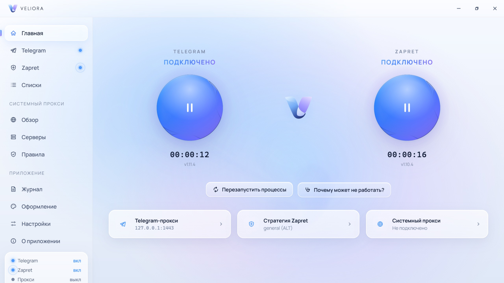
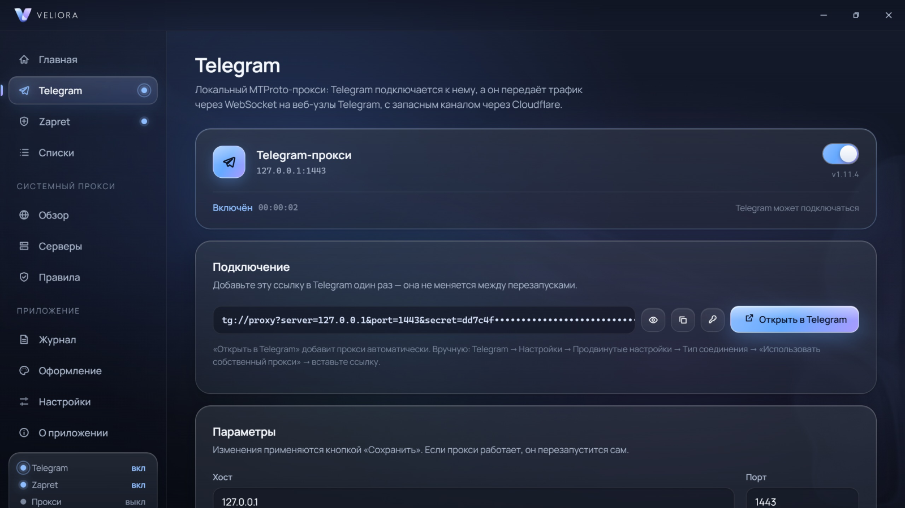
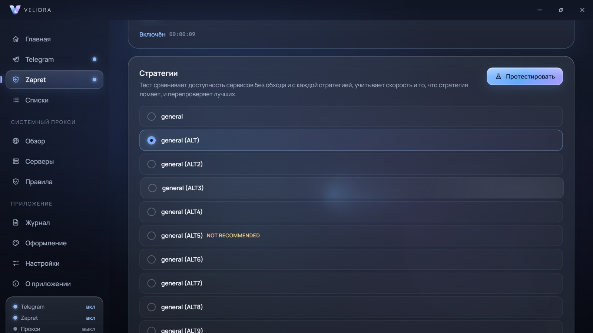
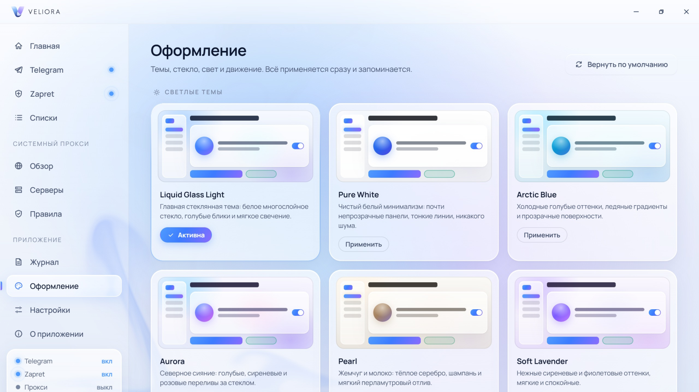

<div align="center">


**Modern Windows application for proxy management and network tools.**

Telegram и свободный интернет в одном окне — для Windows 10/11 x64.

[**Скачать последнюю версию**](../../releases/latest) · [Telegram-канал insomnia project](https://t.me/insomniatype) · [Сообщить о проблеме](../../issues) · [История версий](CHANGELOG.md)

</div>



## Менеджер Zapret

На главной есть быстрый запуск Zapret и Telegram, выбор стратегии и системная диагностика. Установленные темы сохраняются. На чистой установке используется Obsidian.

- В «Каталоге обходов» можно добавить домены сервисов к активной стратегии. Выключение карточки убирает добавленное правило. Встроенные списки Zapret продолжают действовать.
- Добавьте сайт обычной ссылкой в каталоге. Для известных сервисов VELIORA использует готовый профиль. После включения Zapret можно проверить доступность главной страницы.
- Версии Zapret доступны на странице «Zapret». Для загрузки используется официальный выпуск Flowseal с SHA-256 от GitHub. Ранее сохранённые архивы можно выбрать без интернета.
- Telegram-прокси, расширенные списки Zapret, тест стратегии и диагностика Discord доступны отдельно.
- Настройка маршрутизации домена отличается от проверки доступности. Результат работы сайта зависит от стратегии и сети.

Принципы работы и проверка описаны в [документации менеджера](docs/ZAPRET_MANAGER.md).

## Возможности

- **Telegram.** Кнопка на главной подбирает и проверяет сервер из каталога, затем включает прокси на этом компьютере. При первом подключении подтвердите адрес в Telegram. Повторное нажатие выключает прокси и закрывает соединения. Избранное, история проверок и локальный режим доступны в разделе «Telegram».
- **Telegram-прокси.** Локальный прокси (Flowseal/tg-ws-proxy): Telegram подключается к нему по ссылке `tg://proxy`, трафик идёт через WebSocket на веб-узлы Telegram, с запасным каналом через Cloudflare и поддержкой своего Cloudflare Worker. Ссылка добавляется в Telegram в один клик и не меняется между перезапусками.
- **Обход DPI на базе Zapret.** winws + WinDivert со стратегиями Flowseal/zapret-discord-youtube: YouTube, Discord и игры без VPN. Встроенный тест сравнивает доступность контрольных адресов при разных стратегиях. Для голоса и демонстрации Discord нужен отдельный тест со зрителем. Есть игровой фильтр, сменные фейки, режимы IPSet, очистка кеша Discord, установка версий сборки с проверкой SHA-256.
- **Списки Zapret.** Редактор доменов и IP (свои списки и списки сборки), импорт и экспорт, бэкап, заводской сброс. Свои записи переносятся при обновлении сборки.
- **Системный прокси.** Профили HTTP/SOCKS, правила обхода, восстановление прежних настроек Windows.
- **Диагностика «Почему может не работать?».** Находит частые причины (другая программа обхода, отключённая служба Windows, VPN, занятый порт) и даёт пошаговую инструкцию.
- **Журнал** с фильтрами и экспортом, **трей** с быстрыми переключателями, **автозапуск** с Windows без запроса UAC.
- **Оформление.** 14 тем (7 светлых, 5 тёмных, System, Custom), Liquid Glass с бликами и преломлением, анимации и жидкий след за курсором за стеклом. Подробно — [docs/APPEARANCE.md](docs/APPEARANCE.md).

| Telegram | Zapret | Оформление |
|---|---|---|
|  |  |  |

## Обновления VELIORA

Проверка при запуске, ручная проверка в настройках и установка подписанных обновлений через GitHub Releases. [Как работают обновления и как подготовить выпуск](docs/APP_UPDATES.md).

## Установка

1. Скачайте `VELIORA App_<версия>_x64-setup.exe` со страницы [Releases](../../releases/latest).
2. Сверьте SHA-256 файла с указанным в описании релиза: `Get-FileHash .\VELIORA*.exe -Algorithm SHA256`.
3. Запустите установщик. Приложение ставится в Program Files, для этого нужны права администратора.

При запуске VELIORA App просит права администратора. Без них работают Telegram-прокси и системный прокси, а Zapret нет: драйверу WinDivert нужны права. Если включить «Запускать вместе с Windows», приложение стартует через Планировщик заданий сразу с правами, без окна UAC.

Установщик не подписан сертификатом издателя, поэтому Windows SmartScreen может показать предупреждение «Неизвестный издатель». Обход DPI работает через драйвер перехвата пакетов, и некоторые антивирусы реагируют на такие программы (winws, WinDivert). Результат проверки VirusTotal для каждой сборки указан в описании релиза.

## Сборка из исходников

Нужны Node.js 20.19+ (ветка 20) или 22.12+, актуальный Rust stable (MSVC) и Microsoft C++ Build Tools, а также WebView2 (есть в Windows 10/11).

```bash
npm install            # зависимости фронтенда
npm run app:dev        # режим разработки (для проверки Zapret запустите терминал от администратора)
npm run app:build      # exe + установщик NSIS в src-tauri/target/release/bundle/nsis/
```

Публичный релиз собирается скриптом `scripts/release.ps1`: он убирает из exe локальные пути машины сборки, проверяет результат и печатает SHA-256 установщика.

```powershell
powershell -ExecutionPolicy Bypass -File scripts\release.ps1
```

Прочие команды:

```bash
npm run components     # заново скачать сборку Zapret (официальный релиз, сверка SHA-256)
npm run brand          # пересобрать логотипы и иконки
```

Telegram-прокси пересобирается из исходников командой `powershell -ExecutionPolicy Bypass -File scripts\build-tgws.ps1` (подробности — [docs/COMPONENTS.md](docs/COMPONENTS.md)).

Тесты: `cd src-tauri && cargo test`. Команда `cargo test -- --ignored winws` дополнительно проверяет аргументы всех стратегий на настоящем `winws.exe` в режиме `--dry-run`.

## Закрытое тестирование 2.2.5

Для работы нужны 64‑разрядные Windows и WebView2. Проверка кандидата выполнена на Windows 11 25H2. Чистые установки Windows 10 и Windows 11 входят в обязательную проверку перед публичным распространением. Устанавливайте Zapret только в защищённый каталог Program Files. Для Telegram и обычного системного прокси права администратора при запуске не требуются.

Перед удалением отключите «Запускать вместе с Windows», если он включён. Выберите «Выход» в трее или «Настройки → Выход», затем удалите VELIORA App через список установленных программ Windows. Настройки, база, журнал и пользовательские списки могут остаться локально для следующей установки.

В отчёте об ошибке указывайте версию VELIORA, выпуск и сборку Windows, время сбоя, шаги и результат. Для каталога приложите статусы и время ответов по каждому источнику, а для Discord — выбранную стратегию и то, что проверил второй участник. Уберите ключи, ссылки подключения, адреса ваших прокси, имена пользователей и персональные пути. [Пошаговая проверка и известные ограничения](docs/RELEASE_AUDIT.md).

## Структура

```
src-tauri/src/
  lib.rs        команды, трей, окно, автозапуск компонентов, права администратора
  component.rs  надзор за дочерним процессом: job object, журнал, статус
  tgws.rs       Telegram-прокси: запуск, порт, ссылка
  zapret.rs     Zapret: подготовка файлов, разбор стратегий, игровой фильтр, IPSet, списки, кеш Discord
  tester.rs     тест стратегий
  updates.rs    версии сборки Zapret с GitHub (SHA-256)
  diag.rs       диагностика
  autorun.rs    запуск с Windows (Планировщик заданий)
  config.rs     настройки (config.json)
  logs.rs       журнал
  proxy.rs      системный прокси Windows
  win.rs        Win32: процессы, службы, права, адаптеры
src-tauri/components/   TgWsProxy.exe, сборка Zapret, лицензии, components.json (версии и хэши)
src/pages/              Главная, Telegram, Zapret, Списки, Системный прокси, Журнал, Оформление, Настройки, О приложении
src/theme/              темы и движок оформления
docs/                   компоненты, оформление, бренд, дизайн-система, пример настроек
```

## Безопасность и данные

- Приложение не собирает телеметрию и не отправляет ваши данные. Сетевые запросы: проверка версий компонентов через GitHub API (можно отключить в настройках) и тест стратегий, который открывает сайты YouTube, Discord, Google, Cloudflare и Telegram Web.
- Публичные прокси принадлежат сторонним операторам. VELIORA не управляет ими и не гарантирует конфиденциальность соединения.
- Настройки и журнал хранятся локально в `%LOCALAPPDATA%\app.veliora.desktop\`. `config.json` с версии 2.2.5 хранит локальный ключ Telegram в защищённом Windows DPAPI виде. Не публикуйте настройки, базу каталога, старые журналы или ссылки подключения. Пример структуры — [docs/config.example.json](docs/config.example.json).
- Рабочая копия Zapret лежит в `%ProgramData%\VELIORA\zapret\`, писать туда могут только администраторы. Так ничто без прав не подменит программы, которые запускаются с правами.
- Сторонние компоненты поставляются без изменений, их хэши записаны в `src-tauri/components/components.json`.

Подробнее и как сообщить об уязвимости — [SECURITY.md](SECURITY.md).

## Новости и поддержка

- 📢 Новости, обновления и анонсы — Telegram-канал [insomnia project](https://t.me/insomniatype).
- 🐛 Нашли баг или что-то не работает — [создайте Issue](../../issues/new): опишите, что произошло, и приложите журнал (страница «Журнал» → «Сохранить в файл»).

## Лицензия

© 2026 VELIORA. Все права защищены — см. [LICENSE](LICENSE). Исходный код открыт для ознакомления и проверки. Официальные установщики из [Releases](../../releases/latest) можно бесплатно скачивать и использовать.

Сторонние компоненты распространяются по своим лицензиям: список и источники — [THIRD-PARTY-NOTICES.md](THIRD-PARTY-NOTICES.md), тексты лицензий — `src-tauri/components/licenses/` (устанавливаются вместе с приложением).
