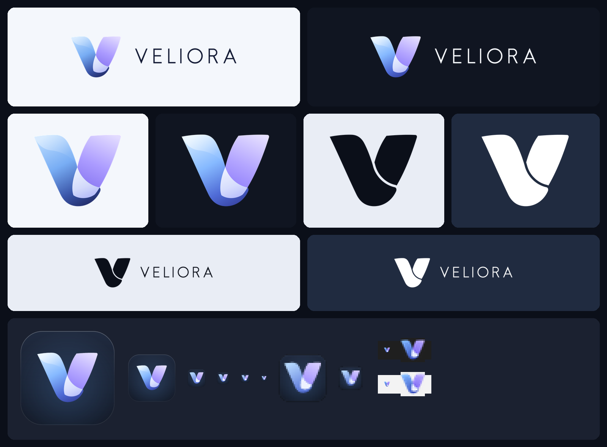

# VELIORA — правила использования бренда



## 1. Идея знака

Знак VELIORA — буква **V**, собранная из двух стеклянных лент.

- **Левая лента** (ледяной голубой → глубокий индиго) — входящий поток, «это устройство».
- **Правая лента** (лаванда) — сервер, точка назначения.
- **Линза** — светлая область, где ленты накладываются друг на друга. Это и есть соединение: два потока сходятся в одну точку.
- **Сгиб** на левой ленте (светлая внутренняя грань) даёт глубину и ощущение материала — стекла, а не плоской заливки.

Знак построен на основе референса заказчика: сохранены две ленты, асимметрия (левая шире), скруглённое основание, светлое перекрытие и широкая разрядка надписи. Геометрия перестроена на сетке 512 × 512, линза вычисляется как точное пересечение лент (а не нарисована отдельно), надпись начерчена вручную и не зависит от шрифтов.

## 2. Состав логотипа

| Элемент | Файл | Когда использовать |
|---|---|---|
| Основной логотип (знак + надпись) | `assets/brand/logo.svg` (= `logo-light.svg`) | Документы, сайты, светлые носители |
| Логотип для тёмного фона | `logo-dark.svg` | Интерфейс приложения, тёмные и стеклянные поверхности |
| Белый монохром | `logo-monochrome-white.svg` | Фото, цветные фоны, гравировка, однокрасочная печать |
| Чёрный монохром | `logo-monochrome-black.svg` | Факс, однокрасочная печать, штампы |
| Знак | `symbol.svg`, `symbol-dark.svg`, `symbol-monochrome-*.svg` | Аватары, иконки, места, где имя уже названо |
| Надпись | `wordmark-light.svg`, `wordmark-dark.svg` | Только вместе со знаком рядом в интерфейсе |
| Иконка приложения | `app-icon.svg/.png/.ico` | Windows: exe, ярлыки, панель задач, установщик |
| Иконка трея | `tray-icon.svg/.png` | Системный трей Windows |

## 3. Пропорции связки

- Высота знака = **2,8 × высота прописной** буквы надписи.
- Расстояние от знака до надписи = **0,95 × высота прописной**.
- Надпись выровнена по оптическому центру знака (на 6 % выше геометрического — у V масса вверху).
- В интерфейсе (компактная связка `variant="inline"`): знак = 1, прописная = 0,42, зазор = 0,36.

## 4. Охранное поле и минимальные размеры

- Охранное поле вокруг логотипа — **¼ высоты знака** с каждой стороны. В `BrandLogo` включается свойством `clearSpace`.
- Минимальная высота знака: **16 px** на экране, **6 мм** в печати.
- Минимальная высота связки: **20 px** (прописная ≈ 8 px). Ниже — только знак.
- Для 16–48 px используется **упрощённый знак** (без сгиба и бликов, усиленный контраст линзы) — он уже заложен в `app-icon.ico` и трей.

## 5. Цвет

| Токен | HEX | Роль в логотипе |
|---|---|---|
| Ice Blue | `#8DBDFF` | верх левой ленты |
| Electric Blue | `#65A9FF` | середина левой ленты, свечения интерфейса |
| Lavender | `#A99BFF` | правая лента |
| Midnight | `#101521` | фон иконки, тёмные поверхности |
| Soft White | `#F4F7FC` | надпись на тёмном |
| Ink | `#121933` | надпись на светлом |

Версия для **светлого** фона опускает низ левой ленты в глубокий индиго `#232E6B` (как в референсе). Версия для **тёмного** фона поднимает его до `#3946A6`, чтобы лента не тонула в Midnight. Не перекрашивайте ленты вручную — используйте готовую версию под фон.

## 6. Так нельзя

- Растягивать, сжимать, наклонять, поворачивать знак.
- Менять местами цвета лент или заливать линзу другим цветом.
- Добавлять тени, обводки, свечения, 3D-эффекты поверх знака.
- Набирать «VELIORA» шрифтом вместо готовой надписи.
- Ставить полноцветный знак на пёстрое фото — используйте белый монохром.
- Писать название иначе, чем **VELIORA** (бренд) и **VELIORA App** (программа).

## 7. Как заменить логотип

Вся геометрия живёт в `scripts/brand/` (`symbol.mjs` — ленты, `wordmark.mjs` — буквы, `compose.mjs` — цвета и версии). После правки:

```bash
npm run brand
```

Скрипт пересоберёт все SVG/PNG/ICO, иконки Tauri, картинки установщика и `manifest.json`. Компонент `BrandLogo` берёт файлы только из `assets/brand/`, поэтому приложение обновится целиком. Можно и просто заменить нужный SVG-файл в `assets/brand/` — он подхватится при следующей сборке.
